# pr-review-workflow

[](https://github.com/Paxton-Meny/pr-review-workflow/releases)
[](LICENSE)
[](https://paxton-meny.github.io/pr-review-workflow/)

A Claude Code plugin that runs the full loop of reviewing a GitHub pull
request: review the diff against categorized criteria, post inline findings,
edit the branch to address them, re-verify with a cheaper model, and repeat
until nothing remains open. Then it merges, or asks you first.

**Contents:** [Status](#status) &#183;
[Requirements](#requirements) &#183;
[What it does](#what-it-does-to-your-repository) &#183;
[Install](#install) &#183;
[Usage](#usage) &#183;
[Settings](#settings) &#183;
[Development](#development) &#183;
[License](#license-and-attribution)

<p align="center"></p>

<p align="center"></p>

## Status

Released and public. The full loop is proven end to end in a live
interactive run: categorized review, a precision filter, per-finding
fix commits authored as the signed-in account, a round-diff skim that
caught and reviewed files no finding covered, cheap-model
verification, an attended merge gate, and a proven rebase merge, with
the run's statistics banked for evidence-based tuning. The eval suite
passes. Current work is accumulating runs across more repositories so
the thresholds can be tuned from the stats ledger.

## Requirements

- `git`
- The GitHub CLI, authenticated. The plugin shells out to it and never
  handles a token itself.
- A local clone of the repository whose pull request you are reviewing; the
  skill runs from inside it.
- Claude Code 2.1.292 or later, the first version that lets a skill set
  each subagent's reasoning effort.

Nothing else. The plugin has no runtime dependencies, no build step, and
nothing to install beyond itself.

## What it does to your repository

Read this before installing. The plugin reads pull requests, posts review
comments to them, pushes commits to their branches, and merges when told to.
Claude may also start a review on its own once a branch's work is
finished; by default you confirm it first (the `self_start` setting).
It acts with whatever access your GitHub CLI credentials carry, and fix
commits are authored as the signed-in account's noreply address, never
your clone's local git identity. The first comment of each review
ends with one line naming and linking this plugin. With the
check command configured, it also runs that command against pull request
code (see SECURITY.md). It never runs migrations or connects to a
database, and a pull request that changes migration files always waits
for a person before it merges.

## Install

From your shell:

```sh
claude plugin marketplace add Paxton-Meny/pr-review-workflow
claude plugin install pr-review-workflow
```

On Claude Code 2.1.275 or later, one command inside a session does both:

```text
/plugin install pr-review-workflow --marketplace Paxton-Meny/pr-review-workflow
```

## Usage

From a clone of the reviewed repository:

```text
/pr-review-workflow:review-pr 128
```

The argument can be a bare number, `owner/repo#128`, or the pull
request URL. One rule about where you run it: start from inside a
clone of the repository the pull request belongs to. If the clone's
origin points anywhere else, the run refuses up front, before
creating state or touching the network. That is the whole tie
between plugin and repository, so review as many repositories as
you like, each from its own clone.

Claude can also start a review itself when it finishes the work on a
branch whose pull request is open. A hook checks the pull request first
and asks you to confirm, with any reason to hold back, such as an
existing review, a draft, or unpushed work. Set `self_start` to `auto`
to skip the question when nothing stands in the way, in your
configuration or, for one repository, in your own project or local
file. A review Claude starts passes `auto_approve=false` and nothing
else, so it never merges without asking you and never carries
settings you did not choose.

Loading with `--plugin-dir` never shows the settings dialog: run
`/plugin configure pr-review-workflow` in the session to fill it in,
or the run uses the defaults and says so.

The loop: a reviewer agent reads the fetched diff (split, line-annotated,
never entering the orchestrating context) and files findings in seven
categories (correctness, security, performance, best practices,
antipatterns, content leakage, outdated docs). Findings post as inline
comments; suggested-change blocks appear only after being applied and
checked in a scratch worktree. An editor agent fixes each finding with its
own commit and replies to each thread; a verifier agent re-checks only the
claimed fixes, resolving threads or reopening them. When nothing is open,
the merge gate runs. The merge uses the method the repository allows
or, where it allows several, the one its recent merged pull requests
used; see the `merge_method` setting. The head branch is deleted only
when the repository does not delete it itself and no open pull request
bases on it.

### Settings

Configured when you enable the plugin. The
[settings reference](https://paxton-meny.github.io/pr-review-workflow/settings.html)
explains each one in plain terms, shows what every value changes on a
pull request, and says when to choose it.

| Option | Default | Meaning |
| --- | --- | --- |
| Auto-approve on convergence | off | Merge without asking once the loop is clean, unless the change touches migrations. When off, you get a prompt: merge now or hold. |
| Merge method | auto | How the pull request merges: merge, squash, or rebase. auto takes the one method the repository allows, else the method its recent merged pull requests into the same base used, judged among pull requests of the same shape (one commit or several); mixed evidence asks you, and parks an unattended run. A project's shared file may set it. |
| Self-started reviews | ask | When Claude starts a review on its own: ask (you confirm first) or auto (no question when the pull request is ready). Anything that is not ready still asks. |
| Check command | empty | The reviewed repository's own check command, used to prove suggestions. Empty restricts suggestions to fixes that apply cleanly. |
| Local standards files | empty | Globs, relative to your clone, of untracked files holding the project's own rules. Their substance guides every category of the review; their names and text never reach the pull request. |
| Second review pass | risky | When a gap pass runs after a single-reviewer first review: off, risky (a secrets, automation, or sensitive probe fired), or always. It reads the existing findings and reports only what they miss. A sharded review always ends with one, whatever this is set to: shards read disjoint file sets, so only a whole-diff pass sees defects that span them. |
| Ledgers kept per repository | 20 | Finished finding ledgers retained per repository; older ones are pruned at the start of each review and after each merge, and a run whose pull request is still open never is. |
| Reviewer / editor / verifier model | inherit / inherit / sonnet | Model per role. The first review deserves your strongest model; verification passes are cheap by design. |
| Model routing | auto | auto picks cheaper models where the work is mechanical: a small docs-only or config-only change with no risk probes gets a sonnet reviewer, a first editing round whose findings are all minor and fence-backed gets a sonnet editor, and a finding reopened past the limit gets one strong arbitration pass before the run parks, since repeated reopens sometimes mean the cheap verifier is wrong. With a strong model set, large code changes, code whose changed files reference one another, and probe-flagged sensitive code climb above the session model. The gap pass never routes down. fixed always uses the configured models. |
| Strong model | empty | Model that auto routing climbs to for large code changes, code whose changed files reference one another, probe-flagged sensitive code (concurrency, crypto, auth, injection surfaces), and arbitration. Example: opus. Empty caps routing at the reviewer model. |
| Sensitive paths | empty | Space-separated globs for files where a defect costs most. A change touching one is treated as high stakes: the reviewer may climb, no fix there starts cheap, and the second review pass runs under risky. A project's shared file adds to this list. |
| Migration paths | common layouts | Space-separated globs for database migration files (default `*[Mm]igrations/* *[Mm]igration/* *db/migrate/* *alembic/versions/*`). A change touching one is treated as high stakes, judged for harm to databases and code teammates already run, and never merged without a person; see Migration safety. Your value replaces the default; a project's shared file adds to it. |
| Cost posture | balanced | Which way routing leans where the change itself does not settle a decision; it never pins a model. economy counts more changes as small enough for the cheap reviewer (under 500 lines, tests-only included), fewer as large enough for the strong one (over 1,200 lines of code), splits into shards over 2,250 changed lines, and starts any fix cheap once a check command gates the round. quality counts small under 150 and large over 400, splits over 1,000, starts only proven-suggestion fixes cheap, adds one review sample where a stakes probe fired, and is the only posture that lets reasoning effort reach xhigh. balanced keeps 300, 800, and 1,500 and also starts fixes cheap whose Check line will execute. High-stakes findings never start cheap; a failed fix tries again one lever up. Fixed routing keeps every model and sample count as set; the shard limit and the effort cap still follow the posture. |
| Review samples | 1 | Independent reviewer passes per shard on the first review. Above 1, duplicates merge into the richest record with a support count the filter weighs; recall rises at roughly that multiple of the review cost. For repositories where an escaped defect is expensive. |
| Precision filter | on | Before findings post, a cheap second context re-reads the cited code and demotes findings the fresh evidence cannot support into the round summary. Nothing is dropped: demoted findings are still addressed, with the doubt recorded in the ledger. |
| Contract command prefixes | empty | Comma-separated prefixes, beyond the check command itself, that a finding's Check line may start with to be executed during verification. Test runners only, never bare interpreters. |

### Per-project settings

The plugin's settings are per user. A repository adds
`.claude/pr-review-workflow.conf`, committed or not as it prefers:
committed, it is the team's shared file, read from the pull request's
base branch and never from disk; kept out of version control, it is
yours, read from your clone. You can also keep an untracked
`.claude/pr-review-workflow.local.conf` in your clone. Settings typed
after the pull request apply to one run:
`/pr-review-workflow:review-pr 128 posture=quality`. Each source
overrides the ones before it: defaults, your configuration, the project
file, your local file, the run. The plugin never reads Claude Code's
own settings files.

```text
# .claude/pr-review-workflow.conf
check_command npm test -- --ci
double_review always
sensitive_paths src/auth/** src/payments/**
```

A committed project file may do less than your own. Its check command and
contract prefixes apply only after you approve them, once per change.
It may set the merge method, since the shape of the history is the
team's choice. It may only raise the review depth settings. It may never set
auto-approve, self-started reviews, the models, ledgers kept, or local standards. The
[settings reference](https://paxton-meny.github.io/pr-review-workflow/settings.html#where)
has the full table.

`/pr-review-workflow:status` shows the settings a review started in
the current clone would use and where each comes from, as of the last
fetch.

`/pr-review-workflow:setup` writes the file for you from what the clone
and its history already state, and works on a repository this plugin
has never seen. Scripts inventory the tracked files, every CLAUDE.md
and AGENTS.md at any depth, the docs, the directories whose code
matches the sensitive probe, and the check command from the Makefile,
package manifest, toolchain, or CI workflow; one `gh` call reads the
last hundred merged pull requests for their sizes by author. The
repository's size sets how much a model reads: nothing on a small one,
up to four, eight, or sixteen cheap parallel readers on a medium,
large, or huge one, each over a planned slice with docs first, and the
estimate is shown before any of them spawn on a large one. A script
drops every claim the tree cannot confirm before the map is drafted.
The history decides what to pin and what to leave to per-run routing:
a developer whose pull requests vary twenty-fold in size gets no depth
setting pinned, while sensitive code or many fork contributors turn
the second review pass on for everyone. It decides whether the file is
the team's or yours unless you say (`team`, `personal`, or `local`),
applies a profile (`standard`, `careful`, or `economy`, which only your
own file may carry), lints the file as the source it will become so a
committed file never holds a line the resolver would refuse, shows it
once beside the drafted conventions block, and writes the file. Every
inferred check command and contract prefix is listed on its own in
that question, and only the ones you confirm by name are written live;
the rest stay comments. The
block reaches CLAUDE.md only when you say so at that question. Pass
`key=value` words to pin anything it would otherwise decide. It touches
no pull request; the one network call lists merged pull requests.

### Executable contracts

A finding may carry a `Check:` line, the check command narrowed to the
relevant test, and verification then runs it instead of judging prose:
execution is the one judge that cannot be argued with. Containment is
strict because reviewers read untrusted pull request content: a Check
line executes only when it starts with your configured check command or
one of the prefixes above, and never when it contains shell
metacharacters. With no check command configured, nothing ever
executes, exactly as before. Running a narrowed test executes no more
of the pull request's code than the check command you already
configured runs on every round.

### Migration safety

Migrations are read, never run. No agent or script executes migration
tooling, a dry run or check mode included, or connects to a database,
and a Check line naming migration tooling is judged by reading
instead. Your own check command is yours to keep database-free.

A pull request touching a migration path gets the high-stakes review
and is judged for harm to databases and code other developers already
run: destructive or renaming changes without an expand-then-contract
step, new required columns without a default or backfill, edits to
migrations that already shipped, and table rewrites or locks.

What one pull request cannot show is left to you. Before any merge
that changes migrations, even with auto-approve on, the review stops
and asks you to confirm that the base branch has no newer migrations
this branch lacks, that no other open pull request adds migrations in
the same directories, that code teammates run still works against the
new schema while it deploys, and that no shipped migration was edited.
Unattended, it parks with that checklist in a status comment.

Setup finds where migrations live by reading the clone: Django,
Alembic, Rails, Laravel, Ecto, Knex, TypeORM, goose, golang-migrate,
Flyway, Liquibase, sqitch, Diesel, and Prisma migrations, and for .NET
and SQL Server, EF Core, FluentMigrator, and DbUp migrations and SSDT
schema projects. It adds any directory the patterns miss, and
recommends narrowing the patterns when they catch a directory that only
shares the name, such as a migration guide under `docs/`. It never
offers migration or database tooling (`dotnet ef`, `sqlcmd`,
`sqlpackage`, `alembic`, and the like) as a check command.

### Cost notes

- Reasoning effort is routed beside the model, independent of your
  session's level. Each agent starts at its definition's level (the
  reviewer high, the editor and the verifier medium, the filter low;
  arbitration runs the verifier at high) and moves one level per
  signal: up for a wide search (large or coupled code unless a stronger
  model takes it, a shard on a seam, a gap pass over seams) or high
  stakes (a secrets, automation, or sensitive probe on a review; a
  blocker, a security finding, or a flagged file on a fix), down where
  a later step checks the work (an editor's minor or nit fix carried
  by a proven suggestion, a verified finding that a Check line or
  proven suggestion settles) or for a small docs or config review. A
  batch or a verified round runs at its highest finding's level. The
  cap is high under economy and balanced and xhigh under quality, a
  signal that climbs the model does not also raise the effort, and
  fixed routing keeps each agent's own level. Adaptive reasoning
  already spends thought where a step is hard, so these moves stay
  coarse.
  The model is the capability ceiling, so it climbs on depth: a
  secrets, automation, or sensitive probe, a declared sensitive path,
  or code whose changed files reference one another (four couplings
  under the balanced posture). Effort is thoroughness, how much the
  agent thinks and how many files it opens, so it climbs on breadth: a
  shard on a seam, a gap pass over seams, and high stakes. Size is
  breadth too, but a stronger model at the same effort costs less than
  the next effort level on a smaller one (xhigh runs about 2.5 times
  the cost of high on coding in Anthropic's published runs) and finds
  more, so large or coupled code climbs the model when one is set and
  the effort otherwise.
- A fix that fails tries again one lever up: more effort on the same
  model while the last attempt ran below the posture's cap (high;
  xhigh under the quality posture), then the next model at that
  effort. Anthropic's published coding runs re-ran failures at a
  higher effort and recovered most of them for about half the cost of
  running everything at the higher level, and routing studies find a
  second model tier captures nearly all the gain a cascade offers. The
  statistics line records which lever each retry pulled and whether
  the finding ended verified, so the balance is tuned from recorded
  runs. Sources:
  Anthropic, Optimizing for cost and intelligence
  (platform.claude.com/docs); Snell et al. 2024 (arXiv 2408.03314);
  Cuadron et al. 2025 (arXiv 2502.08235); Is Escalation Worth It?
  2026 (arXiv 2605.06350).
- `CLAUDE_CODE_EFFORT_LEVEL` outranks every per-spawn effort and so
  defeats effort routing; route lines record it as `pinned`, and a
  retry under it climbs the model directly. The `maxEffortLevel`
  setting caps every routed level without saying so.
- Some sessions give Claude a spawn tool with no effort parameter.
  The run records that once per invocation, omits the effort, and
  route lines name the level each agent actually runs at (its
  definition's) as `unapplied`. A retry then climbs the model
  directly, the final report says routed efforts were not applied,
  and the statistics count those lines and read those attempts at
  the level that ran.
- Subagent requests cache with a five-minute lifetime on every billing
  method (the main conversation gets an hour on a subscription). The
  `subagentPromptCacheTtl` setting raises it, at a higher write rate.
- Parallel reviewer shards read disjoint slices of the diff, so the
  cost math never depends on them sharing a prompt cache; documented
  prefix sharing between sibling agents exists only inside workflow
  runs, not for plain subagents.
- The `CLAUDE_CODE_SUBAGENT_MODEL` environment variable sits below the
  plugin's per-spawn model choices, but
  `CLAUDE_CODE_SUBAGENT_MODEL_FORCE` overrides them entirely and will
  defeat model routing; leave it unset when using this plugin.

### Conventions block (optional)

<details>
<summary>Give the reviewed repository a conventions map that reviews
read instead of re-deriving the project every run.</summary>

Give the reviewed repository a marked block in its tracked CLAUDE.md
(see skills/review-pr/project-conventions.md) mapping its layout, test
locations, idioms, and intentional oddities. Reviews read the map from
the base branch instead of re-deriving those facts every run, and the
same file already guides Claude when developing on the repository.

</details>

### Checking the ledger

`/pr-review-workflow:status` lists the runs recorded for the current
repository (`all` for every repository), each with its finding
outcomes and whether it can resume, plus the accumulated statistics
across finished runs. Local state only; nothing is fetched or
written.

### State

Per-PR state lives under the plugin's data directory, outside every
repository: the finding ledger, fetched context, and a detached review
worktree. Re-invoking the skill on the same pull request resumes from the
ledger. Your own checkout is never touched.
A held run keeps only its ledger: the worktree and fetched context go
when you choose to hold, and come back on resume. Every review starts
by reaping runs, in any repository, whose pull request closed since,
then pruning finished ledgers past the kept count.
State is keyed by repository and pull request, so every worktree of a
clone shares it, and local rule files are found from a linked worktree
by looking in the main one. Run one review per pull request at a time.

<p align="center"></p>

### Limits

- Fork pull requests: full loop when the fork allows maintainer edits;
  review-only (findings and suggestions post, nothing is fixed) when it
  does not.
- Pull requests past the GitHub API diff limits are parked as too large.
- Unattended runs never merge unless auto-approve is on; they park with a
  status comment instead.
- Migration conflicts with the base branch or other open pull requests
  are not detected; the merge gate hands them to you as a checklist.

## Development

Run the gate before every commit:

```sh
sh scripts/gate.sh
```

Activate the pre-commit hook once per clone:

```sh
git config core.hooksPath .githooks
```

See CONTRIBUTING.md for branch naming, commit style, and the review loop
every change goes through.

## Project structure

- `.claude-plugin/plugin.json`: manifest and settings.
- `.claude-plugin/marketplace.json`: the marketplace that lists the plugin.
- `skills/review-pr/`: the orchestrating skill.
- `skills/status/`: read-only view of recorded runs and their statistics.
- `skills/setup/`: writes a repository's settings file from what the clone states.
- `skills/finding-records/`: the finding record format, preloaded into the agents.
- `agents/`: reviewer, filter, editor, and verifier definitions, plus the
  cartographer and assembler that setup spawns to map a repository.
- `hooks/`: the check that runs before Claude starts a review itself.
- `scripts/`: POSIX sh, one proven step each.
- `tests/`: offline suite with a stubbed GitHub CLI.
- `evals/`: `claude plugin eval` cases.
- `docs/`: the static project site.

## License and attribution

Copyright 2026 Paxton-Meny. Licensed under the
[PolyForm Noncommercial License 1.0.0](LICENSE): free to use, change,
and share for any noncommercial purpose, with required credit per the
license.

### Commercial licensing

Use by or for a commercial organization needs a commercial license:
running the plugin on a company's pull requests, selling it, bundling
it into a product, or offering it within a paid service. Terms are
arranged directly and sized to the use. Open an issue titled
"Commercial license inquiry" with a sentence on the intended use, or
reach the maintainer through their GitHub profile for anything better
raised privately.

This is an independent project, not affiliated with or endorsed by
Anthropic. Claude and Claude Code are trademarks of Anthropic, PBC,
named here only to say what the plugin runs on. The [NOTICE](NOTICE) file travels with
every distribution. The name pr-review-workflow identifies this
project: forks and derived works ship under their own name and must
prominently state what they changed, which the license requires. If
this plugin reviews your pull requests, a link back here is
appreciated.
